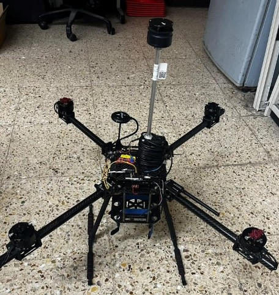
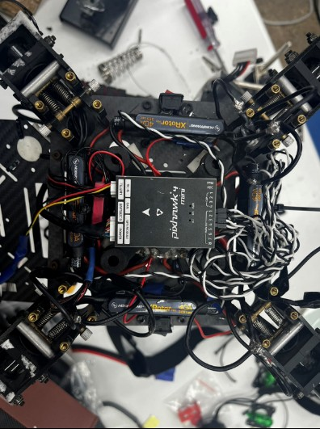
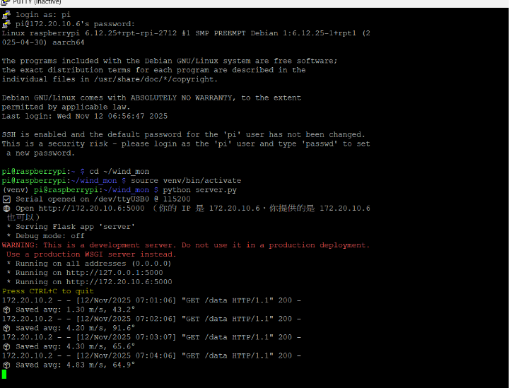
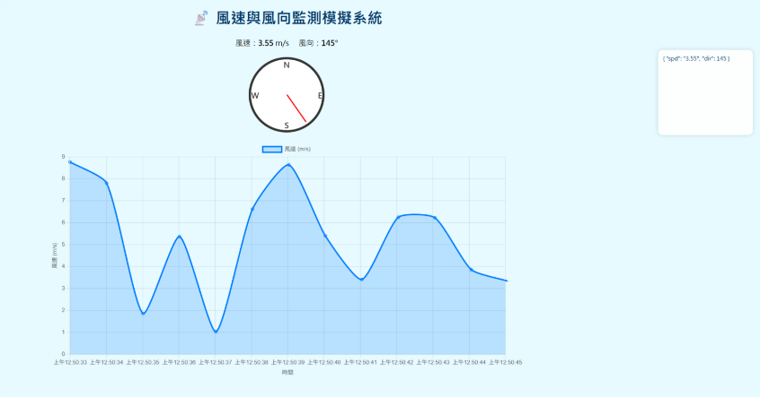
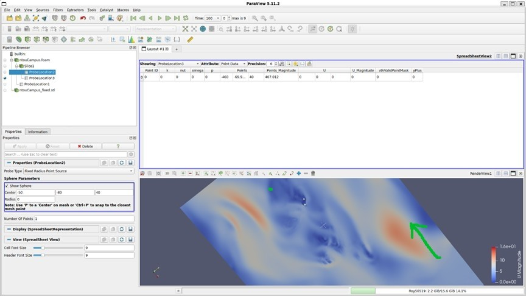

# UAV-Based Wind Field Measurement & CFD Validation System

## 🚀 Overview
A full-stack IoT-UAV platform designed to capture real-time wind dynamics and validate computational microclimate models. By combining custom drone hardware engineering, an IoT data pipeline (Modbus/RS-485), 3D route planning, and OpenFOAM numerical modeling, this system establishes a reliable, data-driven baseline for autonomous UAV navigation in complex urban campus environments.

## 🛠️ System Architecture
Our system features a complete end-to-end data pipeline, from physical sensors to a web-based dashboard:
* **Sensing Layer:** Quadrotor UAV equipped with an ultrasonic anemometer and Pixhawk 4 Mini flight controller for stable vertical profile acquisition up to 40m altitude.
* **Communication Layer (Firmware):** ESP-32S acting as a Modbus RTU master, reading data via RS-485, parsing 16-bit registers into 32-bit floats, and packaging data into JSON format.
* **Processing & Presentation Layer (Software):** Raspberry Pi 5 receiving JSON via USB Serial, performing data average logging, and hosting a Python (Flask) web server for real-time visualization using Chart.js.

### Hardware & System Integration
*(Top: Overall UAV hardware setup | Bottom: Pixhawk 4 Mini & ESC wiring integration)*

### IoT Pipeline & Real-Time Dashboard
*(Top: Python Flask backend terminal logs | Bottom: Frontend Chart.js telemetry dashboard)*

## 💻 Tech Stack
* **Hardware:** Quadrotor UAV, Pixhawk 4 Mini, ESP-32S, Raspberry Pi 5, Ultrasonic Anemometer.
* **Firmware/Software:** C/C++ (Arduino IDE), Python (Flask, pySerial), Modbus RTU, RS-485, HTML/JS/Chart.js.
* **Simulation & Validation:** OpenFOAM ($k-\omega$ SST turbulence model), ParaView, RMSE, Pearson Correlation.
* **Route Planning:** 3D Voxel Mapping, Numpy, STL parsing.

## 📊 CFD Simulation vs. Flight Data
We conducted Computational Fluid Dynamics (CFD) simulations using OpenFOAM to model wind flows across the campus. The numerical models (optimized with a 237k-cell hex mesh and max non-orthogonality < 65) were quantitatively validated against physical flight data across various wind conditions (3 to 8 m/s). Model accuracy was evaluated using RMSE and Pearson correlation metrics.

## 📁 Repository Structure
* `/Firmware_ESP32`: C++ source code for ESP-32S sensor data acquisition and Modbus RTU communication.
* `/Software_RaspberryPi`: Python backend server (`server.py`) and frontend dashboard (`templates/index.html`).
* `/UAV_Route_Planning`: Python algorithms for converting campus `.stl` models into voxel grids and calculating 3D automated routes.
* `/Document`: The complete project report (`UAV_Wind_Measurement_Final_Report.pdf`) containing detailed methodologies and data analysis.
* `/Images`: Screenshots and hardware photographs used in this documentation.
